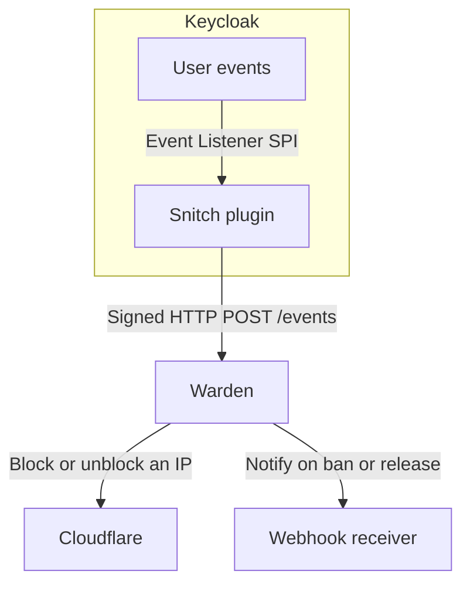

# Keycloak Warden

Warden watches for repeated failed logins from the same IP address. [Keycloak Snitch](https://github.com/gi8lino/keycloak-snitch) sends the login events. You choose how many failures trigger a ban, how long it lasts, and whether Warden blocks the IP through Cloudflare or sends a webhook.



## Try it locally

From the repository root, start the Docker Compose demo and follow its logs:

```sh
make e2e-up
make e2e-logs
```

Open the [demo realm’s account console](http://127.0.0.1:18080/realms/warden-e2e/account/) and sign in as `demo` with a wrong password twice within one minute. Look for a webhook with `"active": true` in the receiver logs. The demo uses Hookglass to verify and log signed webhook deliveries, so you can try it without a Cloudflare account.

Press Ctrl+C to stop following the logs, then run `make e2e-down` to stop the stack. The [Compose guide](examples/e2e/README.md) includes the automated end-to-end test.

## Deploy on Kubernetes

Follow the [Kubernetes guide](examples/kubernetes/README.md) to connect Snitch to your realm, configure a destination, and deploy Warden.

## Check whether Cloudflare applied a ban

When the CLI prints `Banned`, Warden has recorded the decision. To confirm delivery, check the Warden logs:

```sh
kubectl -n keycloak logs deployment/keycloak-warden --since=10m
```

Look for `delivery_completed` with `active: true` for your Cloudflare destination and decision. If you see `delivery_failed`, the error explains why the attempt failed. Warden retries automatically.

To check in Cloudflare, open **Security → Security rules** for the configured zone. Under **IP access rules**, look for the blocked IP and the note `warden:<decision-id>`.

## License

[Apache 2.0](LICENSE)
