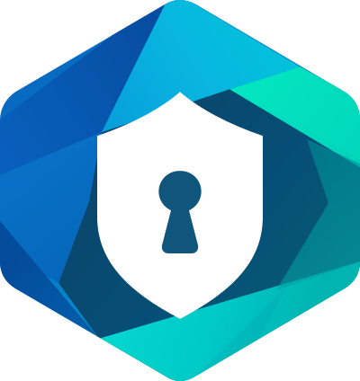
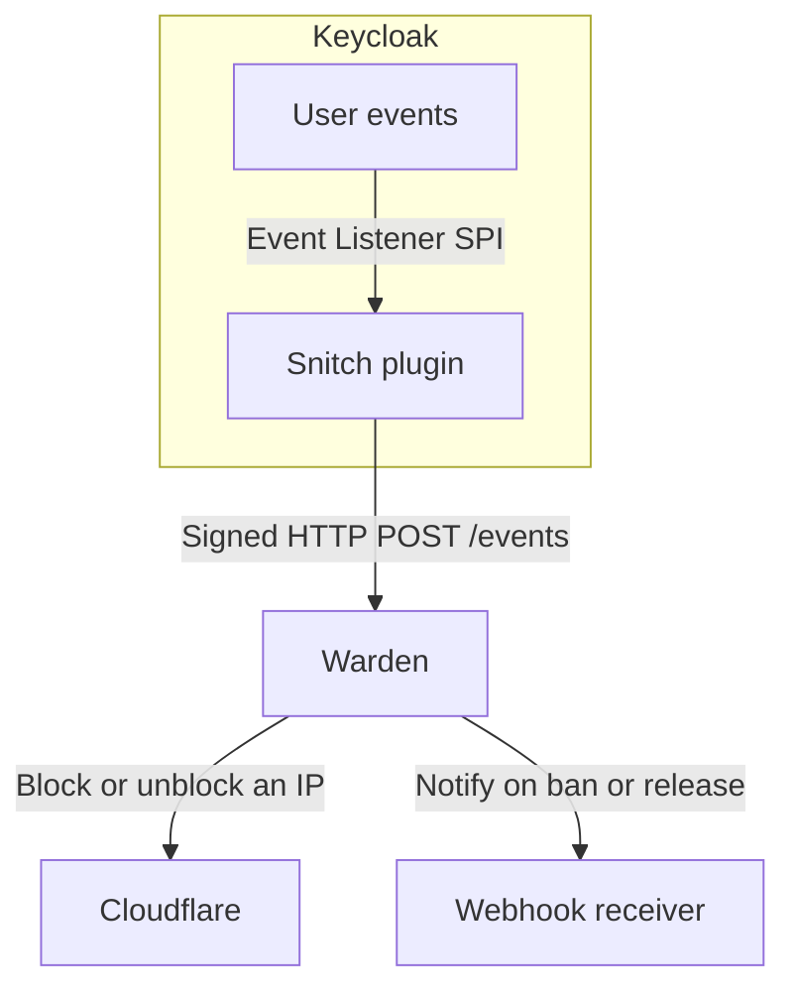

# Keycloak Warden

<p align="center">
  
</p>

Warden watches for repeated failed logins from the same IP address. [Keycloak Snitch](https://github.com/gi8lino/keycloak-snitch) sends the login events. You choose how many failures trigger a ban, how long it lasts, and whether Warden blocks the IP through Cloudflare or sends a webhook.



## Try it locally

From the repository root, start the Docker Compose demo and follow its logs:

```sh
make e2e-up
make e2e-logs
```

Open the [demo realm’s account console](http://127.0.0.1:18080/realms/warden-e2e/account/) and sign in as `demo` with a wrong password twice within one minute. Look for a webhook with `"state": "banned"` in the receiver logs. The demo uses a local receiver, so you can try it without a Cloudflare account.

Press Ctrl+C to stop following the logs, then run `make e2e-down` to stop the stack. The [Compose guide](test/e2e/README.md) includes the automated end-to-end test.

## CLI Commands

Warden provides commands for running the server, managing IP bans, and inspecting persisted decisions. All administrative commands use the authenticated HTTP API of a running Warden instance.

| Command       | Description                                                              |
| :------------ | :----------------------------------------------------------------------- |
| `serve`       | Start the HTTP server, event receiver, and delivery worker.              |
| `ban`         | Manually ban one or more IP addresses.                                   |
| `unban`       | Remove bans for one or more IP addresses.                                |
| `list-active` | List active bans, their sources, and delivery status.                    |
| `inspect`     | Inspect one or more decisions and their delivery acknowledgements by ID. |

### Examples

```
# Start Warden
warden serve --config warden.yaml

# Manually ban an IP
warden ban 203.0.113.10 --duration 1h --reason "Suspicious activity" --admin-token "$WARDEN_ADMIN_TOKEN"

# Ban multiple IPs
warden ban 203.0.113.10 203.0.113.11 --duration 1h --reason "Investigation" --admin-token "$WARDEN_ADMIN_TOKEN"

# Remove bans
warden unban 203.0.113.10 203.0.113.11 --admin-token "$WARDEN_ADMIN_TOKEN"

# List active bans
warden list-active --admin-token="$WARDEN_ADMIN_TOKEN" -o json

# Inspect multiple decisions
warden inspect ID1 ID2 --admin-token="$WARDEN_ADMIN_TOKEN" -o json
```

Use `warden --help` to see the available commands, or `warden <command> --help` for command-specific flags and environment variables.

CLI command results use YAML by default; specify `--output=json` for scripts. The legacy `--output=text` value is accepted as a YAML alias.

## Configuration

Warden reads detection rules and provider-grouped, named targets from `warden.yaml`. At least one webhook or Cloudflare target is required; Warden does not run in monitoring-only mode. Each configured target receives the same decision independently and retries failed delivery. To disable a target, remove it from the configuration after ensuring it no longer owns any active bans. Do not remove the final target.

```yaml
rule:
  threshold: 5
  window: 1m
  ban: 15m

targets:
  webhook:
    edge:
      url: env:WEBHOOK_URL
      headers:
        Authorization: env:WEBHOOK_AUTHORIZATION
        X-Source: warden
        X-API-Key: file:/run/secrets/webhook-api-key

  cloudflare:
    primary:
      zone-id: env:CLOUDFLARE_PRIMARY_ZONE_ID
      api-token: env:CLOUDFLARE_PRIMARY_TOKEN
    secondary:
      zone-id: env:CLOUDFLARE_SECONDARY_ZONE_ID
      api-token: env:CLOUDFLARE_SECONDARY_TOKEN
```

The example creates three independent destinations: `webhook.edge`, `cloudflare.primary`, and `cloudflare.secondary`. Provider-qualified names are used in delivery records, logs, and metrics.

Cloudflare targets require `zone-id` and `api-token` (the zone ID must resolve to 32 hexadecimal characters). Webhook targets require `url`; `headers` are optional. Header names are literal HTTP field names; each value and the URL can use a resolver. Header values must not be blank or contain invalid HTTP control characters. Warden reserves `Content-Type` and always sends JSON with `Content-Type: application/json`. Other syntactically valid headers are allowed; Go's HTTP transport may override or reject protocol-specific fields. Webhooks have no built-in signing: configure an `Authorization` or API-key header if required by the receiver.

All `url`, `headers` values, `zone-id`, and `api-token` entries accept literal values or [Resolver](https://github.com/containeroo/resolver) sources including `env:VARIABLE` and `file:/path/to/value`. Use `literal:` to escape a special prefix (for example, `literal:env:not-a-reference`). Missing or blank values and unrecognized references cause startup to fail. Values are resolved once at startup; restart Warden after rotating them.

Warden requires HTTPS webhook endpoints, except HTTP on explicit loopback hosts (`localhost`, `127.0.0.1`, or `::1`). Redirects are not followed. **Inbound events from Snitch are still authenticated with HMAC signatures**; the optional webhook headers apply only to outbound notifications.

The YAML parser rejects unknown fields, including the removed flat target format, `provider`, `enabled`, and `signing-secret`. There is no compatibility mode.

For Kubernetes, use a ConfigMap for the rules and destination definitions and Kubernetes Secrets for credentials. See the Kubernetes example for an end-to-end configuration.

## SQLite maintenance

Warden runs `PRAGMA optimize=0x10002` when opening SQLite, and performs periodic `PRAGMA optimize` for query-planner statistics. It also deletes stale login observations, retaining each observation for at least 24 hours (or longer when required by the configured detection window). Optimization does **not** run a full `VACUUM`; SQLite keeps free pages for reuse, and WAL checkpoints remain managed by SQLite.

The `serve` command provides independent intervals (also configurable through
`WARDEN__PRUNE_INTERVAL` and `WARDEN__OPTIMIZE_INTERVAL`):

```sh
warden serve --config warden.yaml --prune-interval=1h --optimize-interval=24h
```

Both intervals must be between `5m` and `8760h` (one year). Stale observation pruning runs once on startup, then at the configured interval. Optimization runs once when SQLite opens, then on its configured interval. Maintenance failures are logged and retried; they do not stop security event processing. Intervals configure **when** cleanup runs, not how long observations are retained.

## Deploy on Kubernetes

Follow the [Kubernetes guide](deploy/kubernetes/README.md) to connect Snitch to your realm, configure a destination, and deploy Warden.

## Check whether Cloudflare applied a ban

When the CLI prints `Banned`, Warden has recorded the decision. To confirm delivery, check the Warden logs:

```sh
kubectl -n keycloak logs deployment/keycloak-warden --since=10m
```

Look for `delivery_completed` with `state: banned` for your Cloudflare destination and decision. If you see `delivery_failed`, the error explains why the attempt failed. Warden retries automatically.

To check in Cloudflare, open **Security → Security rules** for the configured zone. Under **IP access rules**, look for the blocked IP and the note `warden:<decision-id>`.

## License

Licensed under the [Apache License, Version 2.0](LICENSE).
