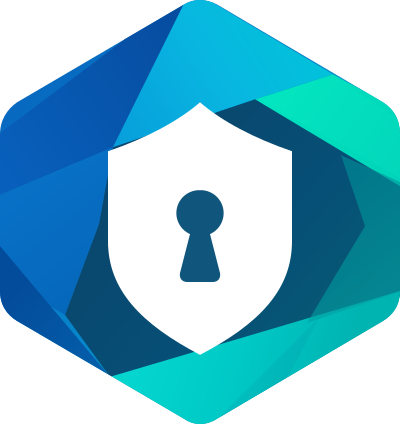
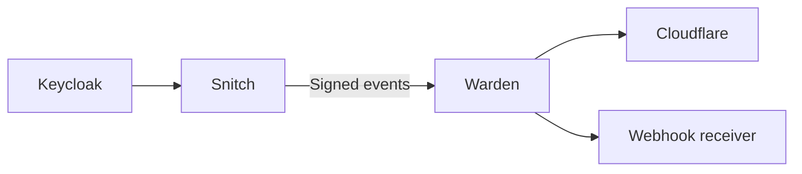

# Keycloak Warden

<p align="center">
  
</p>

**Security event detection and automatic IP banning for Keycloak.**

Warden evaluates named detection rules against user and administrative events reported by [Keycloak Snitch](https://github.com/gi8lino/keycloak-snitch) and can automatically block offending IP addresses through Cloudflare or HTTP webhooks. Named rule threshold hits are recorded as incidents and can independently notify selected Slack, Teams or webhook destinations.

It uses SQLite to persist decisions, supports manual bans and protected IPs/CIDRs, and reliably retries failed deliveries. Observe-only mode records hypothetical automatic bans without enforcing them. Exhausted current-revision deliveries can be explicitly retried without discarding their attempt history. An append-only revision journal records new ban, release, and extension events for the authenticated administration API.

## How it works



## Quick start

Run the local Docker Compose demo with Keycloak, Snitch, Warden, and a webhook receiver:

```sh
make e2e-up
make e2e-logs
```

Open the [demo Keycloak realm](http://127.0.0.1:18080/realms/warden-e2e/account/) and attempt to sign in as `demo` with an incorrect password twice within one minute.

Watch the logs to see Warden detect the failures, create a ban, and deliver the notification.

Stop the demo with:

```sh
make e2e-down
```

## Documentation

Full documentation is available at **[gi8lino.github.io/keycloak-warden](https://gi8lino.github.io/keycloak-warden/)**.

- [Getting Started](https://gi8lino.github.io/keycloak-warden/getting-started/)
- [Configuration](https://gi8lino.github.io/keycloak-warden/configuration/)
- [Architecture](https://gi8lino.github.io/keycloak-warden/architecture/)
- [CLI Reference](https://gi8lino.github.io/keycloak-warden/cli/)
- [Deployment](https://gi8lino.github.io/keycloak-warden/deployment/)
- [Operations](https://gi8lino.github.io/keycloak-warden/operations/)

## License

Licensed under the [Apache License, Version 2.0](LICENSE).
