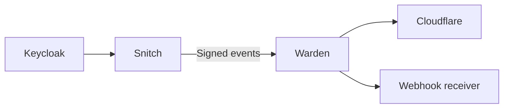

# Keycloak Warden

<p align="center">
  
</p>

**Automatic IP banning for Keycloak.**

Warden monitors failed login attempts reported by [Keycloak Snitch](https://github.com/gi8lino/keycloak-snitch) and automatically blocks offending IP addresses through Cloudflare or HTTP webhooks.

It uses SQLite to persist decisions, supports manual bans, and reliably retries failed deliveries.

## How it works



## Quick start

Run the local Docker Compose demo with Keycloak, Snitch, Warden, and a webhook receiver:

```sh
make e2e-up
make e2e-logs
```

Open the [demo Keycloak realm](http://127.0.0.1:18080/realms/warden-e2e/account/) and attempt to sign in as `demo` with an incorrect password twice within one minute.

Watch the logs to see Warden detect the failures, create a ban, and deliver the notification.

Stop the demo with:

```sh
make e2e-down
```

## Documentation

Full documentation is available at **[gi8lino.github.io/keycloak-warden](https://gi8lino.github.io/keycloak-warden/)**.

- [Getting Started](https://gi8lino.github.io/keycloak-warden/getting-started/)
- [Configuration](https://gi8lino.github.io/keycloak-warden/configuration/)
- [Architecture](https://gi8lino.github.io/keycloak-warden/architecture/)
- [CLI Reference](https://gi8lino.github.io/keycloak-warden/cli/)
- [Deployment](https://gi8lino.github.io/keycloak-warden/deployment/)
- [Operations](https://gi8lino.github.io/keycloak-warden/operations/)

## License

Licensed under the [Apache License, Version 2.0](LICENSE).
