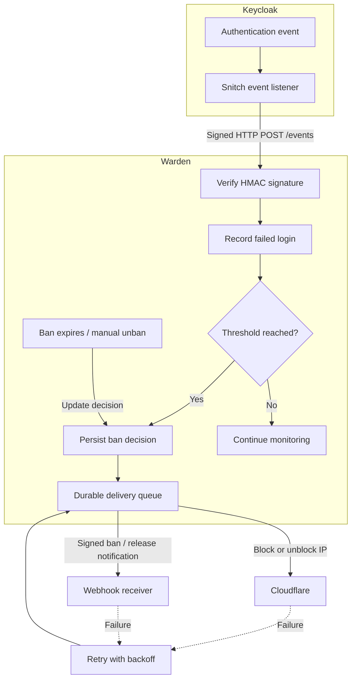

# Keycloak Warden

Keycloak Warden protects against repeated failed login attempts by detecting suspicious activity and automatically banning IP addresses. [Keycloak Snitch](https://github.com/gi8lino/keycloak-snitch) forwards authentication events from Keycloak using HMAC-signed webhooks.

Configure how many failed logins trigger a ban, how long it lasts, and where ban decisions are enforced or delivered.



## Try it locally

Use the **E2E Docker Compose stack** to start Keycloak with Snitch, Warden, and [Hookglass](https://github.com/gi8lino/hookglass), which verifies and logs Warden's HMAC-signed webhooks.

From the repository root:

```sh
make e2e-up       # Build and start the stack; print the Keycloak realm URL
make e2e-logs     # Follow Keycloak, Warden, and Hookglass logs
make e2e-test     # Reset and verify the complete detection and delivery flow
make e2e-down     # Stop the stack
```

Open the [E2E demo account](http://127.0.0.1:18080/realms/warden-e2e/account/) (or the account URL printed by `make e2e-up`) and attempt to sign in as `demo` using an incorrect password **twice within one minute**.

Warden detects the repeated failures, creates an automatic ban, and delivers a signed notification to Hookglass. Look for `event=webhook_received` with `"active":true` in the receiver logs.

The demo uses these credentials:

- Test user: `demo` / `dev-password`
- Keycloak administrator: `dev-admin` / `dev-admin-password`
- Automated test client: `smoke`

The [Keycloak admin console](http://127.0.0.1:18080/admin/master/console/) uses the administrator credentials above. The Snitch listener is enabled in the `warden-e2e` realm, not the `master` realm.

The demo uses Hookglass instead of Cloudflare, so no Cloudflare account is required. Run `make e2e-test` to verify the complete flow, including automatic banning, authenticated unbanning, and signed release notifications.

See the [E2E guide](examples/e2e/README.md) for additional configuration, endpoints, and troubleshooting instructions.

All credentials and HTTP endpoints in this example are **for local development only**.

## How it works

Warden receives authentication events from Snitch, validates their HMAC signatures, and records qualifying failed logins by IP address.

When the configured threshold is reached within the detection window, Warden creates an automatic ban decision.

Ban decisions are persisted in SQLite and delivered asynchronously to configured destinations:

- **Cloudflare** — Blocks or unblocks IP addresses using Cloudflare IP access rules.
- **Webhook** — Sends HMAC-signed ban and release notifications to an external service. The receiving service decides how to act on them.

Each destination receives the desired state of the decision. Warden retries failed deliveries with exponential backoff, allowing temporary destination outages without losing pending decisions.

When a ban expires or is manually removed, Warden updates the decision and delivers the release state.

**A recorded ban is not necessarily an enforced ban.** Warden can record a decision before the external destination acknowledges it. Check delivery logs to confirm successful enforcement.

## Configuration

Warden uses a YAML configuration file to define detection rules and delivery targets.

For example:

```yaml
rule:
  threshold: 5
  window: 5m
  ban: 15m

targets:
  receiver:
    enabled: true
    provider: webhook
    url: https://hooks.example.com/warden
    secret: replace-with-a-strong-shared-secret
```

This configuration creates a 15-minute automatic ban after five qualifying failures from the same IP address within five minutes, then notifies the configured webhook receiver.

The inbound Snitch secret is configured separately using `WARDEN__SNITCH_SECRET`. It must match `KC_SPI_EVENTS_LISTENER__SNITCH__WEBHOOK_SECRET` in Keycloak.

The outbound webhook secret is independent of the Snitch secret and is used to sign notifications sent by Warden.

See [`examples/e2e/warden.yaml`](examples/e2e/warden.yaml) for a working webhook configuration and [`examples/kubernetes/warden.yaml`](examples/kubernetes/warden.yaml) for a Kubernetes deployment example.

## Deploy on Kubernetes

Follow the [Kubernetes guide](examples/kubernetes/README.md) to configure Warden, connect Keycloak Snitch, and deploy the service.

The deployment uses separate application and management endpoints. Configure the appropriate signing secrets, destination credentials, and persistent SQLite storage before deploying.

For Cloudflare integration, create an API token with the required permissions for the specific zone you want to protect.

## Verify ban delivery

When Warden records an automatic or manual ban, it does not wait for external enforcement before reporting the decision.

To inspect destination delivery, check the Warden logs:

```sh
kubectl -n keycloak logs deployment/keycloak-warden --since=10m
```

Look for these events:

- `delivery_starting` — Warden is attempting to reconcile the decision with a destination.
- `delivery_completed` — The destination successfully acknowledged the decision.
- `delivery_failed` — Delivery failed and will be retried.

The `active` field distinguishes ban and release notifications:

- `active: true` — Apply or maintain the ban.
- `active: false` — Release the ban.

For Cloudflare, verify that the IP appears in the zone's IP access rules. Warden identifies managed rules using the `warden:<decision-id>` note.

For webhook destinations, inspect the receiver logs or its delivery records.

## License

Licensed under the [Apache License, Version 2.0](LICENSE).
