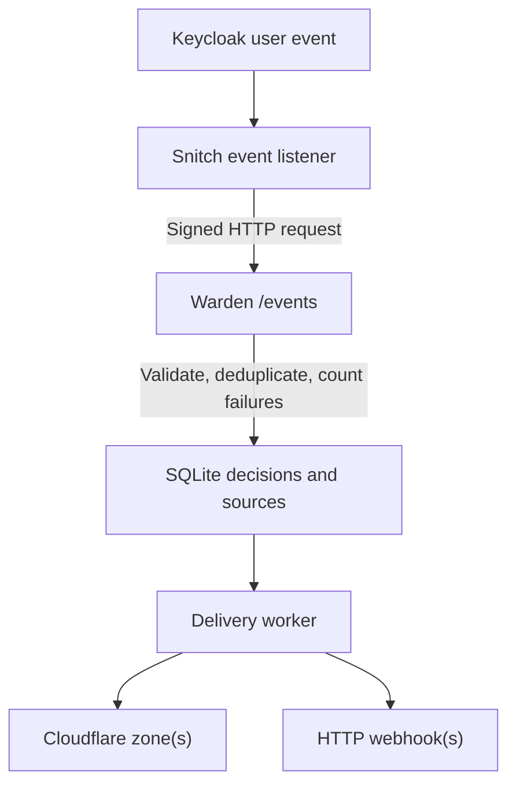

# Architecture

Warden has a small pipeline: **event ingestion → detection → durable desired state → independent delivery**.

## Ingestion and detection

Keycloak Snitch sends signed event envelopes to the application listener. Warden validates the event contract, normalizes the client IP, and processes matching Keycloak `LOGIN_ERROR` events. The rule counts distinct failures within the configured sliding window, keyed by **IP address**, not by user or realm.

When the threshold is reached, Warden records or extends a decision in SQLite. Duplicate events do not cause duplicate observations.

## Desired versus delivered state

A decision's `state` is either `banned` or `unbanned`. This is **Warden's desired state**, not proof that an external system has already applied it. Each destination acknowledges revisions independently, and unsuccessful deliveries are retried.

Automatic expiry or a manual unban changes the desired state to `unbanned`. A manual ban and an automatic ban are independent sources; releasing an IP removes the active reasons for blocking it.

The administrative API, `list-active`, and `inspect` return the same record shape: `decision`, `sources`, and `deliveries`. `sources` describes the independent currently active automatic or manual reasons for a block, while `deliveries` contains the last acknowledged revision for each destination. A released decision retains its historical identity and delivery acknowledgements, but has no active sources.

A webhook receives only the desired decision (`id`, `revision`, `ipAddress`, `state`, and `expiresAt`). Failure observations are retained internally for detection and replay protection, not exported as part of the decision.

## Package responsibilities

- `internal/application`: detection, event ingestion, bans, and action-delivery orchestration.
- `internal/sqlite`: persisted observations, decisions, sources, delivery acknowledgements, and migrations.
- `internal/providers`: Cloudflare and webhook delivery implementations.
- `internal/http`: authenticated application endpoints and separate operational routes.
- `internal/metrics`: Prometheus metrics, with disabled registries acting as no-ops.
- `internal/maintenance`: independent pruning and SQLite optimization schedules.
- `internal/command`: CLI commands and startup orchestration.

## Two listeners

The application listener serves `POST /events` and, when an admin token is configured, authenticated `/bans` routes. The independent management listener serves `/healthz`, `/readyz`, and optionally `/metrics`.

`--route-prefix` applies to the application routes. Management paths stay at their root paths.

See [API](api.md) for the endpoints and [Operations](operations.md) for maintenance and readiness behavior.
