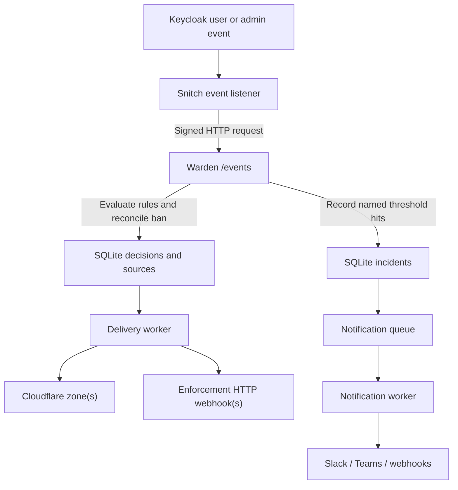
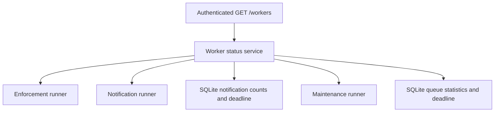

# Architecture

Warden has a small pipeline: **event ingestion → detection → durable enforcement and incident notifications → independent delivery**.

## Ingestion and detection

Snitch snapshots native user and opt-in administrative event metadata and submits it after the Keycloak transaction commits. Warden authenticates the request and validates the versioned event contract. Both event categories use schema version 2.

Ingestion selects matching rules, deduplicates the observation, counts each rule's aggregation key within its receive-time window and records named threshold hits. Ban rules request an IP block through `bans`; overlapping rules reconcile the longest qualifying duration once. Observation, incident, notification admission and decision writes commit together. Incidents reference an existing effective decision even if it did not change.

| Package                     | Responsibility                                                              |
| --------------------------- | --------------------------------------------------------------------------- |
| `application/events`        | Validate and canonicalize typed event envelopes                             |
| `application/detection`     | Rule matching, aggregation criteria and threshold crossings                 |
| `application/ingestion`     | Atomic observation, rule evaluation, ban and incident coordination          |
| `application/bans`          | Source admission and effective desired state                                |
| `sqlite`                    | Transactional observation counts, incident storage and decision persistence |
| `application/enforcement`   | Desired-state delivery and retry lifecycle                                  |
| `application/notifications` | Incident delivery, independent retry policy and worker lifecycle            |
| `application/overview`      | Read-only administrative projections                                        |
| `bootstrap`                 | Resolve destinations and validate startup admission                         |
| `command/serve`             | Compose services and own database, worker and listener lifecycles           |

Incident records are independent of ban revisions and are available through the administrative API. Notification jobs are inserted atomically with incidents and carry immutable snapshots. The enforcement queue handles ban and release reconciliation only. A separate worker handles notification jobs; it never calls ban providers.

## Desired versus delivered state

An append-only source mutation journal records persisted additions, changes and removals independently of decision revisions; source-only edits do not trigger outbound reconciliation. These records start with the source journal migration and are bounded on individual inspection.

A decision's `state` is either `banned` or `unbanned`. This is **Warden's desired state**, not proof that an external system has already applied it. Each destination acknowledges revisions independently, and unsuccessful deliveries are retried.

SQLite stores these values in the constrained `decisions.state` column.

Automatic expiry or a manual unban changes the desired state to `unbanned`. A manual ban and an automatic ban are independent sources; releasing an IP removes the active reasons for blocking it.

Maintenance computes the observation retention cutoff from the longest configured detection window (at least 24 hours) and supplies that cutoff directly to SQLite. Incident retention is independent. Destination identity fingerprints are persisted to protect existing enforcement obligations from reassignment.

The administrative API, `list-active`, and `inspect` return the same record shape: `decision`, `sources`, and `deliveries`. `sources` describes the independent currently active automatic or manual reasons for a block, while `deliveries` contains the last acknowledged revision for each destination. A released decision retains its historical identity and delivery acknowledgements, but has no active sources.

A webhook receives only the desired decision (`id`, `revision`, `ipAddress`, `state`, and `expiresAt`). Failure observations are retained internally for detection and replay protection, not exported as part of the decision.

## Two listeners

The application listener serves `POST /events` and, when an admin token is configured, authenticated `/bans` routes. The independent management listener serves `/healthz`, `/readyz`, and optionally `/metrics`.

`--route-prefix` applies to the application routes. Management paths stay at their root paths.

See [API](api.md) for the endpoints and [Operations](operations.md) for maintenance and readiness behavior.

## Ban reconciliation ownership

The `bans` application package evaluates source extension and effective decision revisions. SQLite exposes transactional read/write primitives and synchronizes persisted delivery rows without interpreting ban policy.

## Worker observability

The background workers run independently: the enforcement worker handles ban expiry, destination delivery and retries, the maintenance worker handles scheduled database pruning and optimization, and the optional notification worker handles incident delivery. All three runners expose concurrency-safe `Snapshot()` methods. The maintenance snapshot also backs `GET /maintenance`; enforcement queue statistics and deadlines remain in SQLite, not in the runner. The authenticated `GET /workers` endpoint combines these snapshots with persisted queue counts and deadlines.

## Delivery retry backoff

The `enforcement` package calculates the capped exponential retry delay (default 10 seconds up to 5 minutes, configurable under `enforcements` with `retry-initial-delay` and `retry-max-delay`) using the destination's last persisted delay. SQLite only loads the previous delay and atomically stores the calculated pause and retry deadline along with the attempt result.

## Expiry and release workflows

`bans` orchestrates manual releases and source expiry using atomic `TransactDecision` callbacks. The application clears sources, advances the observation generation, computes effective decisions and enqueues delivery revisions; SQLite provides only the corresponding persistence primitives. The enforcement worker delegates expiry to `bans.ExpiryService`.

## Policy and persistence boundaries

At startup, SQLite reports the destinations that still own bans or unacknowledged revisions; `enforcement.ValidateTargets` decides whether the configured target set is safe. The application owns the delivery attempt-limit decision (`enforcement.AttemptLimit.AfterFailure`), while SQLite counts recorded attempts and applies status updates transactionally. Startup binds enforcement and notification identities and reconciles enforcement attempt budgets in one transaction, after application admission checks. The administrative history API returns bounded, numbered-page snapshots using SQLite LIMIT/OFFSET; all attempts remain durably stored, including successful responses that arrive after a newer revision supersedes an in-flight attempt. Such stale completions never advance current acknowledgements or backoff state.

## Decision revision audit trail

Warden appends an immutable revision snapshot whenever the effective desired decision changes. The journal captures the commit time, workflow cause, requested state, expiry, and active source reasons. This write shares the original decision transaction, so an unsuccessful transaction cannot leave behind a misleading history entry. Historic revisions prior to migration 0008 cannot be reconstructed from the current decision row.

The authenticated `/decisions/history` query reads this journal. `/deliveries` instead reads the current revision from existing delivery tables, including release attempts.

Both delivery sections embed the same YAML delivery settings and use `internal/retry` for capped exponential backoff. The generic webhook provider is unaware of ban or incident semantics. Notification history and explicit retries are independently persisted; operator retries never reset lifetime attempt numbering.
