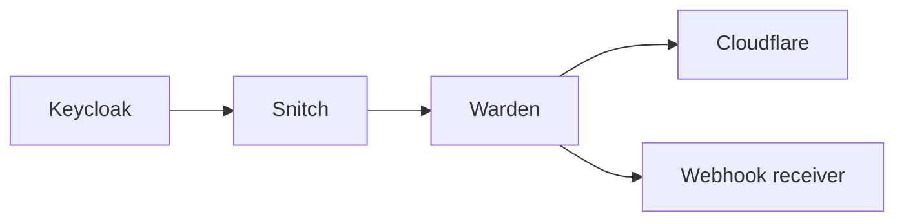

# Keycloak Warden

**Detect security events and protect your Keycloak services.**

Warden receives authenticated security events from [Keycloak Snitch](https://github.com/gi8lino/keycloak-snitch), evaluates named detection rules, records security incidents, and keeps the desired ban state synchronized with Cloudflare and/or HTTP webhook destinations.

## Why Warden?

- **Focused detection.** Named rules for user and administrative events, with sliding windows and distinct identity counting.
- **Authenticated ingestion.** Snitch signs outbound events; Warden verifies the shared HMAC secret.
- **Durable decisions.** SQLite persists ban decisions, sources, and destination delivery acknowledgements.
- **Independent delivery.** Named Cloudflare zones and webhook endpoints each receive updates, with retries.
- **Operator control.** Ban and unban addresses via the CLI and authenticated application API.
- **Simple operations.** A single Go service, separate application and management listeners, health probes, and optional Prometheus metrics.

## Get started

1. [Run the local demo](getting-started.md) with Docker Compose and a real Keycloak instance.
2. [Configure rules and destinations](configuration.md) for your environment.
   See [Detection rules](detection-rules.md) for the complete rule reference and examples.
3. [Deploy Warden](deployment.md) and connect Keycloak Snitch.

For how reconciliation, expiration, and storage work, see [Architecture](architecture.md). For manual bans and diagnostics, see [CLI](cli.md), [API](api.md), and [Operations](operations.md).

[Browse the source on GitHub](https://github.com/gi8lino/keycloak-warden) · [Download a release](https://github.com/gi8lino/keycloak-warden/releases)
